# Ball-and-Plate PID Balancer

A Raspberry Pi platform that keeps a ping-pong ball balanced on a tilting plate. It uses a webcam, OpenCV ball tracking and PID control of three servos.

**Built:** January 2026 · Control Systems lab project

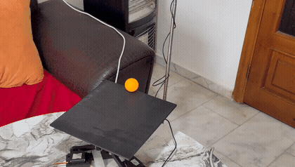

## Results

| Metric | Result |
| --- | --- |
| Continuous balance in the demo | 61 s, ball never left the plate ([full video](media/demo.mp4)) |
| Control loop | About 10 Hz, camera to servos |
| Final tuning | PD: Kp 0.25, Kd 0.08, Ki 0 |
| Model check | Refined plant model predicts a stable but lightly damped loop (24° phase margin), matching the demo |

## How it works

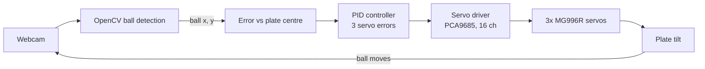

1. **Calibrate:** on the live camera feed, you click the plate centre and its four edges, then drag a crop box around the plate. Nothing is hard-coded to one camera position.
2. **Detect:** the cropped frame goes through an HSV colour mask and a median blur. The largest contour above a minimum area is the ball, and its enclosing circle gives the position.
3. **Mix:** the servos sit in a triangle, so the x/y error is converted into one error per servo:
   `e0 = -dx + dy`, `e1 = dx + dy`, `e2 = -dy`.
4. **Control:** a PID loop runs at about 10 Hz. The final tuning was PD (Kp 0.25, Kd 0.08, Ki 0), and servo travel is limited to about ±5° around level to protect the mechanism.
5. **Tune live:** a Tkinter window has Kp/Ki/Kd sliders, start/stop and a servo reset, so you can tune without restarting.

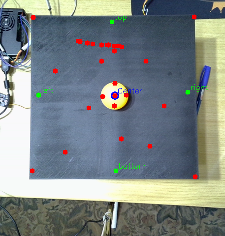

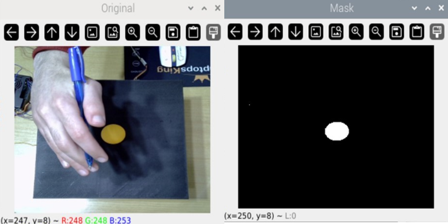

*Ball detection: the live camera view (left) and the HSV mask that isolates the ball (right).*

<details>
<summary><b>Full program flowchart</b></summary>

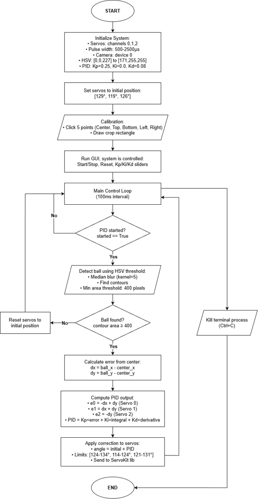

</details>

## Control software

| Main control panel | Plate pose calibrator |
| --- | --- |
| 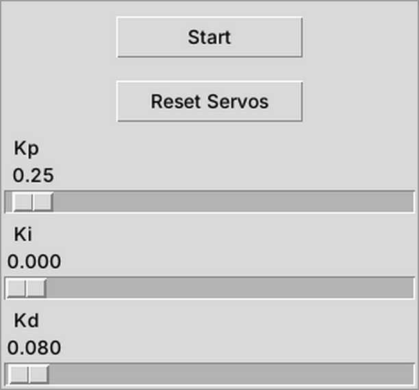 | 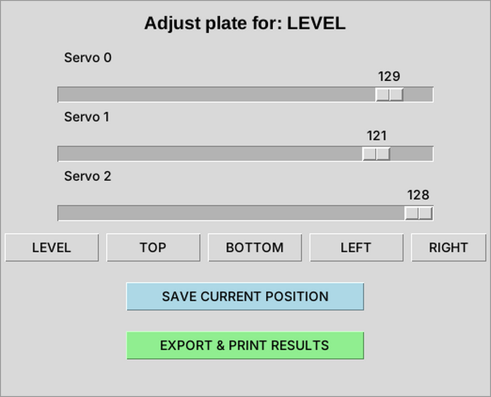 |
| Start/stop, servo reset and live PID gain sliders (final tuning shown) | Find and save the level, top, bottom, left and right servo poses to JSON |

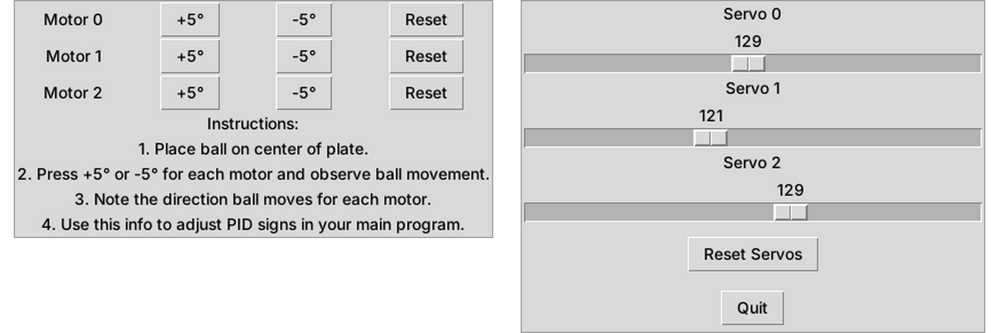

*Servo test tools: step each motor ±5° to learn which way the ball rolls (left), or move each servo with a slider (right).*

## Hardware

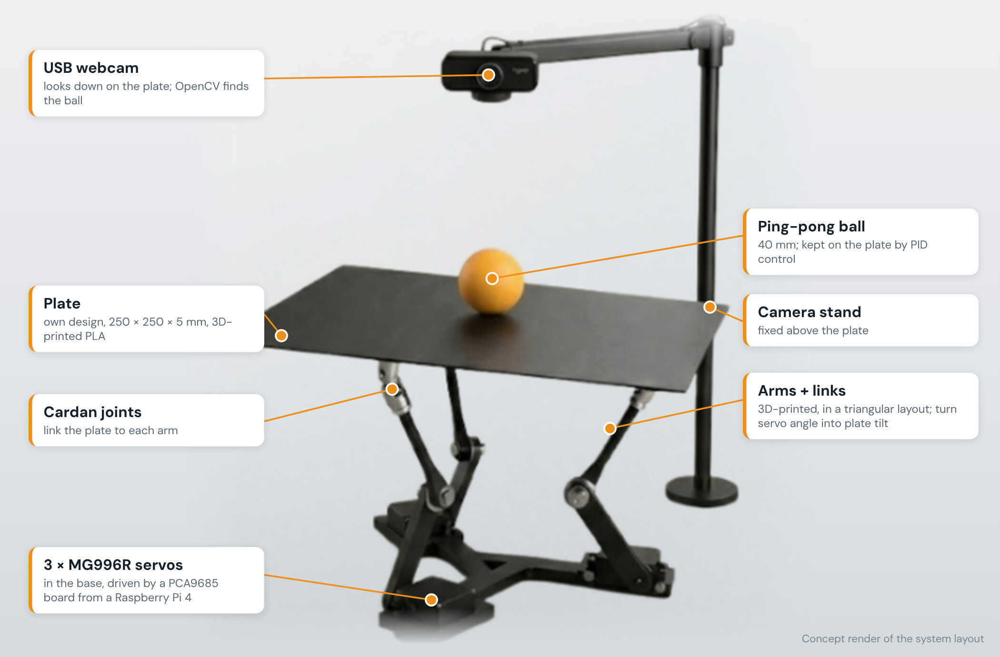

*System layout*


| Part | Notes |
| --- | --- |
| Raspberry Pi 4 | Runs vision, control and GUI |
| USB webcam | Mounted above the plate |
| PCA9685 16-channel servo driver | Driven with Adafruit ServoKit |
| 3x MG996R servos | Triangular layout |
| 3D-printed arms + cardan joints | Plate linkage (original design) |
| Custom plate | 250 × 250 × 5 mm, designed and 3D-printed in PLA |
| Bench power supply | Separate supply for the servos |

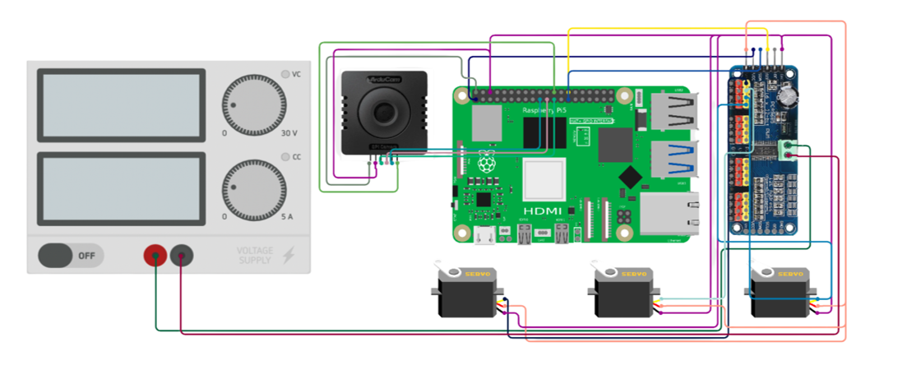

*Wiring overview. The diagram tool's parts show a Pi 5 and a ribbon camera; the build used a Raspberry Pi 4 and a USB webcam.*

## Repository layout

| File | Purpose |
| --- | --- |
| `ball_plate_pid.py` | Main program: calibration, tracking, PID, GUI |
| `tools/plate_pose_calibrator.py` | Slider GUI to find level/top/bottom/left/right servo poses; saves `plate_calibration.json` |
| `tools/servo_manual_test.py` | Move each servo by hand to check wiring and direction |
| `tools/servo_sweep_test.py` | One slider per servo across its full travel, plus reset |
| `tools/camera_ball_test.py` | Find the camera and check ball detection |
| `matlab/stability_analysis.m` | Root locus, Bode, step response and margins for the PID design |
| `matlab/run_full_simulation.m` | Discrete-time simulation of both axes with a 3D animation of the ball |
| `matlab/BallOnPlateModel.slx` | Simulink model of the X and Y loops |
| `analysis/model_check.py` | Compares the two plant models and the effect of the 10 Hz loop (Python, `control` library) |

## Run it

```bash
pip install -r requirements.txt
python ball_plate_pid.py
```

The servo angle limits and level pose at the top of `ball_plate_pid.py` depend on the build. Find yours with `tools/plate_pose_calibrator.py` (run it from inside `tools/`) before running the main program.

## Modelling

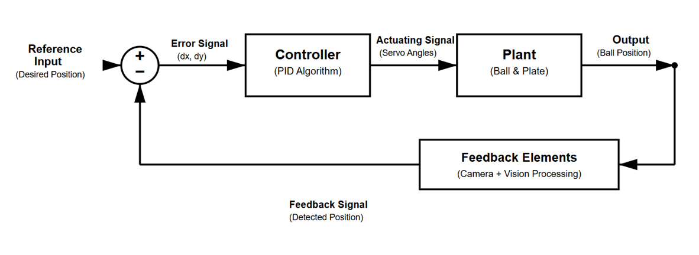

The ball dynamics were derived with a Lagrangian and linearized at zero tilt. Because of symmetry, the x and y axes share one transfer function: a double integrator from servo angle to ball position.

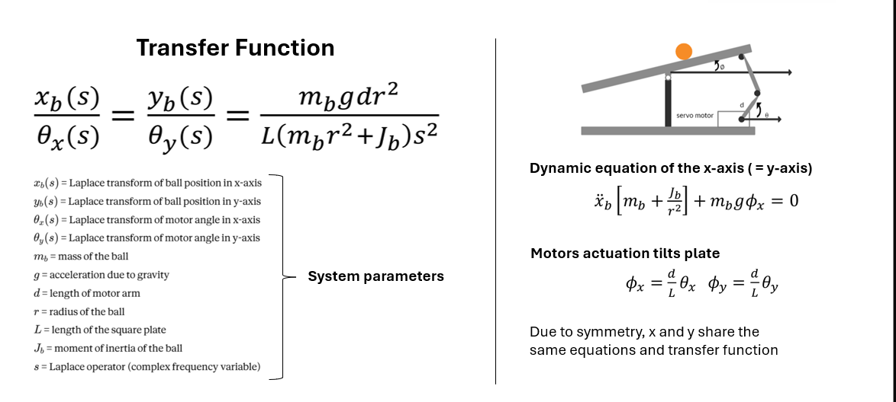

Both axes were simulated in Simulink with a step setpoint, plus a 3D animation of the ball on the plate. Parameters: ball mass 2.7 g, ball radius 20 mm, ball inertia 7.2 × 10⁻⁷ kg·m² (thin shell), motor arm 50 mm, plate 250 mm. The slide shown below uses an earlier 300 mm estimate; the analysis below uses the real 250 mm.

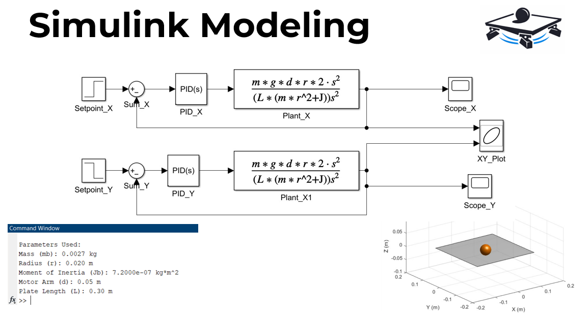

## Engineering notes

**Two plant models.** The first model treats the ball as solid and the plate tilt as the input: G(s) = (5/7)g / s² ≈ 7.0 / s². This is the version in the MATLAB/Simulink files. The refined model (transfer function above) accounts for the hollow ping-pong ball (J = ⅔mr²) and the servo-arm lever (d/L = 50/250 mm). From servo angle to ball position it gives G(s) ≈ 1.18 / s², about 6× less gain.

Here is the same PID (Kp 2.5, Ki 0.1, Kd 1.2) on each model, from `analysis/model_check.py`:

| Plant model | Overshoot | Settling | Phase margin | 10 Hz loop + 1-frame camera delay |
| --- | --- | --- | --- | --- |
| Solid ball, plate tilt (7.0/s²) | 14% | 1.3 s | 76° | Unstable (−23°) |
| Hollow ball, servo arm (1.18/s²) | 37% | 5.9 s | 43° | Stable, 24° |

What this shows:
- **Model detail changes the design.** The simpler model makes the gains look excellent, but it would go unstable at the real loop rate.
- **PD is enough.** The integral term barely acts (its closed-loop pole sits at −0.04), so the hardware ran with Ki = 0.
- **The camera loop is the bottleneck.** At 10 Hz with a frame of delay, the phase margin drops to about 24°. That matches the demo: the ball stays on the plate but keeps moving instead of settling at the centre. A faster camera loop (30 Hz or more) is the first upgrade.

The hardware gains are in degrees per pixel, so they are not directly comparable to the model gains.

## Challenges and fixes

- **The model didn't match the hardware.** PID was tuned on the real rig through the live sliders.
- **The plate oscillated near the edges.** Servo travel was clamped tightly and the plate poses were calibrated.
- **The behaviour was hard to see.** Separate test and calibration tools were written for each component.

## Limitations and next steps

- The 10 Hz camera loop limits damping: the ball stays on the plate but doesn't settle at the centre. A faster camera pipeline (30 Hz or more) is the first upgrade.
- Gains were tuned by hand on the rig; a model-based tuning step using the refined plant model is next.
- The ball is found by colour, so lighting changes need the HSV range re-tuned.

## Credits

The mechanical design (3D-printed parts) and the original concept come from [nicohmje/PID-ballonplate](https://github.com/nicohmje/PID-ballonplate). Get the STL files from that repository. The control software in this repo was rewritten from scratch: calibration, detection, servo mixing, PID and GUI.

## Author

**Michel Salame** — [LinkedIn](https://www.linkedin.com/in/michel-salame)
